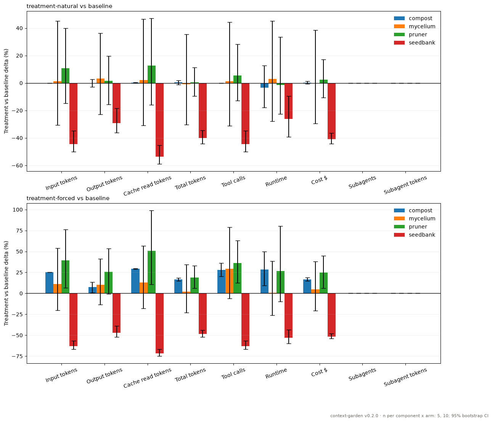

# 🌱 Context Garden

[](https://github.com/oliverweissl/context-garden/actions/workflows/ci.yml?query=branch%3Amain)
[](https://github.com/oliverweissl/context-garden/actions/workflows/app-ubuntu.yml?query=branch%3Amain)
[](https://github.com/oliverweissl/context-garden/actions/workflows/app-macos.yml?query=branch%3Amain)
[](https://github.com/oliverweissl/context-garden/actions/workflows/app-windows.yml?query=branch%3Amain)

Self-contained Agent Skills that cut an agent's context usage: deterministic, offline, no LLM
calls inside the tooling. Optionally with **ContextGarden**, a desktop app for whole platforms.

**[See the showcase →](https://oliverweissl.github.io/context-garden/)**

## Install

Two options. Both give you the same six skills; the app adds one window around them.

| | Full app | Skills only |
|---|---|---|
| For | multi-repo platforms, several agents and accounts | any Claude Code setup |
| You get | gardens of repos, skills per garden, agent terminals, dashboard | the six skills, hooks and agents |
| Needs | `git`; Claude Code and/or Codex; `gh` / `glab` for orgs and groups | Claude Code |

### Option 1: Full app (ContextGarden)

**From a release.** Download the installer for your OS from
[Releases](https://github.com/oliverweissl/context-garden/releases): `.dmg` (macOS),
`.msi` / `.exe` (Windows), `.deb` / `.rpm` / `.AppImage` (Linux). The builds are not
code-signed yet, so the first start needs one extra step:

- **macOS:** right-click ContextGarden in Applications, then Open (or
  `xattr -dr com.apple.quarantine /Applications/ContextGarden.app`).
- **Windows:** SmartScreen, then "More info", then "Run anyway".
- **Linux:** `sudo apt install ./ContextGarden_*.deb`, or `chmod +x` the `.AppImage` and run it.

**From source.** Needs Rust ([rustup](https://rustup.rs)), Node 18+ and the
[Tauri prerequisites](https://tauri.app/start/prerequisites/) for your OS (WebView2 on
Windows, `webkit2gtk` on Linux):
```bash
git clone https://github.com/oliverweissl/context-garden && cd context-garden/app
npm install
npm run tauri dev      # run it
npm run tauri build    # or build the installer: src-tauri/target/release/bundle/
```

**Then:** add your accounts (optional; the app signs in through the agent CLI and installs the
skills into each), start a garden from repos, folders, GitLab groups or GitHub orgs, take the
recommended skills, and open agents side by side. Apart from the skills it installs nothing,
never touches agent credentials, and shows a button when a newer release or newer skills are out. More:
[`app/README.md`](app/README.md).

### Option 2: Skills only

As a Claude Code plugin (all six skills, their hooks and agents):
```text
/plugin marketplace add oliverweissl/context-garden
/plugin install context-garden@context-garden
/context-garden:setup    # skills start off: pick the ones for your use case
```
Or copy single skills (their hooks then need the settings snippet in the skill's `references/`):
```bash
cp -r skills/{skill} ~/.claude/skills/{skill}   # or the project's .claude/skills/
```

## The skills

| Skill | Does |
|---|---|
| 🌰 [`seedbank`](skills/seedbank) | Promotes repeatedly-rediscovered repo facts into a small, always-loaded `AGENTS.md`. |
| ✂️ [`pruner`](skills/pruner) | Returns exact `file:start-end` ranges worth reading (Python + C/C++) instead of grep-exploring. |
| ♻️ [`compost`](skills/compost) | Compacts huge compiler/test/CI/HPC output into clustered summaries. |
| 🍄 [`mycelium`](skills/mycelium) | Gates subagent delegation (bounded brief, no duplicate investigations) and shares finding notes between agents. |
| 🏡 [`greenhouse`](skills/greenhouse) | Shared memory across the repos of one platform: per-repo cards (provides, depends on, key facts) beside the repos. |
| 🌾 [`weeder`](skills/weeder) | Shrinks a Skill's always-loaded token cost without losing instructions. |

<!-- benchmark-figure:begin -->
Benchmark results for **v0.2.0** on the small fixtures in this repo, run with Claude Code ([summary](docs/benchmarks/v0.2.0/summary.md); older versions in [`docs/benchmarks/`](docs/benchmarks)):


<!-- benchmark-figure:end -->

## Turn skills on

**Every skill starts `off`**: nothing runs, not even the hooks, until you choose. The app does
this per garden; with the plugin run `/context-garden:setup` (it asks), name a preset
(`/context-garden:setup platform`, add `--scope user` for every repo), or ask Claude
("turn on compost and pruner").

| You work... | Preset | Turned on |
|---|---|---|
| in one repo, everyday coding and debugging | `solo` | seedbank, pruner, compost |
| on several repos that call each other (services, shared packages, APIs) | `platform` | + greenhouse |
| with many subagents per task | `swarm` | + mycelium |
| with many agents across a multi-repo platform | `platform-swarm` | + greenhouse, mycelium |
| mostly with long builds, test suites, CI or HPC/SLURM logs | `logs` | compost only |

Each skill is `on` (Claude uses it when relevant), `manual` (only when you call it, e.g.
`/context-garden:compost summarize the failing pytest run`) or `off`. Skills a preset does not
turn on become `manual`; `all` turns everything on, `off` hides the reminder.

<details>
<summary>Where modes are stored, scopes and overrides</summary>

Modes are Claude Code's own `skillOverrides` setting, most specific first:
`.claude/settings.local.json` (this repo, only you; default), `.claude/settings.json` (this
repo, shared), `~/.claude/settings.json` (every repo):
```json
{"skillOverrides": {"compost": "on", "pruner": "user-invocable-only"}}
```
`"user-invocable-only"` is `manual`; a skill with no entry is `off`.
`CONTEXT_GARDEN_MODE_<SKILL>=on|manual|off` overrides everything for one shell. Copied skills
can also be switched with `skills/<skill>/bin/<skill> mode on|manual|off [--scope ...]`.
Claude Code ignores `skillOverrides` for plugin skills, so each skill checks its mode when it
loads; its one-line description is still listed (about 60-100 tokens). To drop that too, copy
the skill or `/plugin disable context-garden`.
</details>

## Hooks and agents

Skills teach Claude *how* to do a job; the deterministic parts run as hooks, and jobs worth
delegating ship as agents. Every hook is a no-op unless its skill is `on` (except a
session-start reminder to run `/context-garden:setup` while no skill has a mode).

Started in a folder of many repos (not itself a git repo), each hook works on the repo the
action touched (the file read, the `cd` target, the error's paths, an agent's notes), as if
the session had started there. The folder itself gets only mycelium's spawn log, and only
when an agent brief names no repo.

| Skill | Hook | Agent |
|---|---|---|
| compost | before Bash: a raw build/test command is denied with the compost command to run instead (`hook` in `.compost/config.json`: `redirect`, `ask`, `rewrite`, `off`) | |
| pruner | on prompt submit: a pasted traceback/compiler error gets a slice as context | preloaded into `scout` |
| seedbank | after Read/Grep/Glob and read-only Bash: record observations in the touched repo; at stop: once per session, ask to curate this session's candidates | `gardener` curates and promotes |
| mycelium | before Agent: brief gate; when an agent stops: record its `Notes:` block | `scout` read-only search |
| greenhouse | session start: platform overview, or ask where the base is; session end: card sync if the base opted in | `envoy` reads another repo's checkout |
| weeder | | `weeder` runs the whole slimming workflow |

## Development

```bash
skills/{skill}/bin/{skill} --help
bash skills/{skill}/tests/smoke_test.sh   # offline, bundled fixtures
```
[`docs/architecture.md`](docs/architecture.md) (layout, self-containment rule, design principles) ·
[`docs/skill-development.md`](docs/skill-development.md) (adding a Skill) ·
[`docs/benchmarking.md`](docs/benchmarking.md) (running and plotting benchmarks) ·
[`examples/`](examples) (measured before/after) ·
[`app/README.md`](app/README.md) (the desktop app).
Contributing: [`CONTRIBUTING.md`](CONTRIBUTING.md). License: [`LICENSE`](LICENSE).
